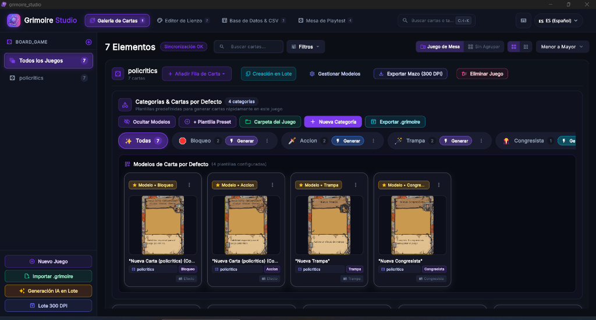
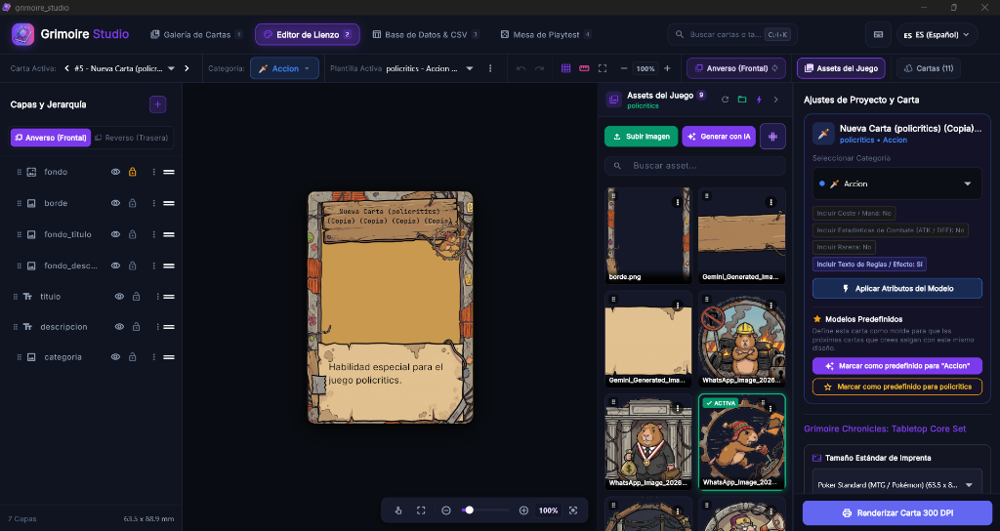
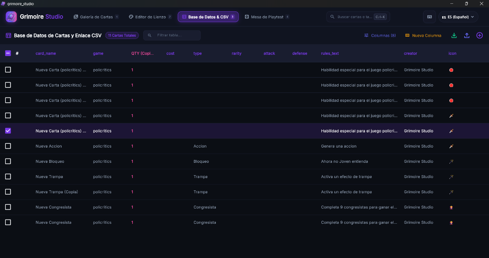
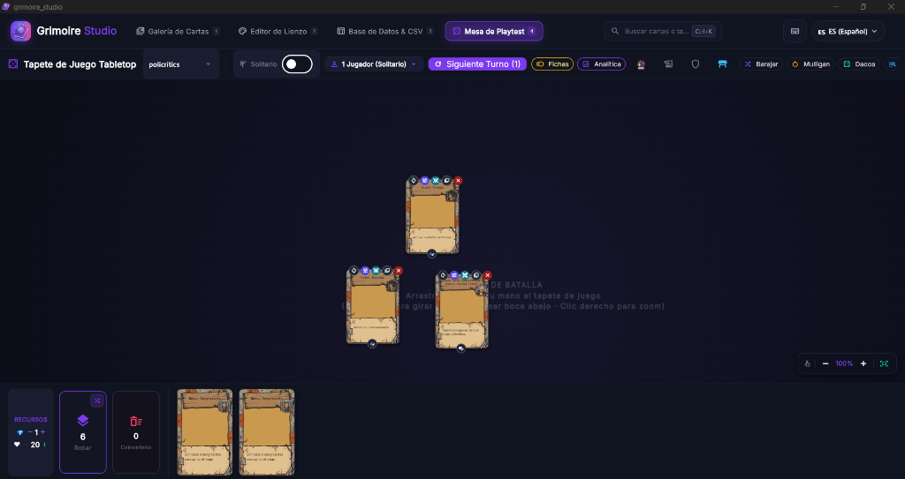

# 🧙‍♂️ Grimoire Studio

<div align="center">


### El entorno definitivo de diseño, prototipado y playtesting para juegos de cartas y de mesa
**Diseña cartas con capas dinámicas, genera arte con IA o ComfyUI local, gestiona bases de datos y prueba tus mecánicas en una mesa virtual Tabletop lista para imprimir o jugar.**

[](https://flutter.dev)
[](https://dart.dev)
[](#)
[](LICENSE)
[](#)
[](#)
[](https://paypal.me/brunoap19)

</div>

---

## 📸 Vistas de la Aplicación

<div align="center">

### 1. Galería de Cartas y Modelos Predefinidos por Categoría
*Organiza tus juegos, categoriza tipos de cartas y define maquetas/modelos preestablecidos sin alterar cartas existentes.*


<br/>

### 2. Editor Visual de Lienzo (Anverso y Reverso) & Gestión de Assets
*Diseño por capas vectoriales, textos dinámicos con etiquetas `{card_name}`, recorte de fondo y biblioteca de assets organizada en carpetas.*


<br/>

### 3. Base de Datos de Cartas y Sincronización CSV
*Vista interactiva en hoja de cálculo con edición en celda, columnas personalizadas, filtros y creación en lote.*


<br/>

### 4. Mesa de Playtest Tabletop (Simulador de Juego)
*Prueba tus cartas en tiempo real: arrastre libre, giro de 90° (tap), cartas boca abajo (trampas/secretos), tirador de dados poliédricos, fichas y modo solitario o duelo.*


</div>

---

## 📖 Tabla de Contenidos

1. [¿Qué es Grimoire Studio?](#-qué-es-grimoire-studio)
2. [Características Principales](#-características-principales)
   - [🗂️ Galería y Modelos Predefinidos por Categoría](#️-galería-y-modelos-predefinidos-por-categoría)
   - [🎨 Editor Visual de Lienzo (Anverso y Reverso)](#-editor-visual-de-lienzo-anverso-y-reverso)
   - [📁 Organización de Assets en Carpetas](#-organización-de-assets-en-carpetas)
   - [📊 Base de Datos de Cartas y Enlace CSV](#-base-de-datos-de-cartas-y-enlace-csv)
   - [🎲 Mesa de Playtest Tabletop (Simulador Virtual)](#-mesa-de-playtest-tabletop-simulador-virtual)
   - [✨ Generación de Arte con IA y Conector ComfyUI](#-generación-de-arte-con-ia-y-conector-comfyui)
   - [✂️ Divisor de Sprites y Sprite Sheets](#️-divisor-de-sprites-y-sprite-sheets-sprite-splitter)
   - [📦 Exportación, Print & Play y Paquetes `.grimoire`](#-exportación-print--play-y-paquetes-grimoire)
3. [🤖 Guía Completa de ComfyUI](#-guía-completa-de-comfyui)
4. [⌨️ Atajos de Teclado](#️-atajos-de-teclado)
5. [🚀 Instalación y Ejecución](#-instalación-y-ejecución)
   - [Instalador para Windows](#instalador-para-windows)
   - [Para Desarrolladores](#para-desarrolladores)
6. [🏗️ Estructura del Proyecto](#️-estructura-del-proyecto)
7. [🤝 Contribuir](#-contribuir)
8. [💖 Apoya el Proyecto](#-apoya-el-proyecto)
9. [📄 Licencia](#-licencia)

---

## 🔮 ¿Qué es Grimoire Studio?

**Grimoire Studio** es una suite de escritorio integral diseñada para acelerar y profesionalizar cada fase en la creación de juegos de mesa y cartas coleccionables (**TCG, CCG, LCG y Board Games**).

Permite trabajar de forma unificada desde la concepción de reglas y balance en base de datos, pasando por el diseño gráfico con plantillas y capas dinámicas, generación de ilustraciones con IA local o remota, hasta el testeo interactivo en un simulador de mesa virtual y la exportación en alta resolución (300 DPI) lista para imprimir o importar en Tabletop Simulator.

---

## ⚡ Características Principales

### 🗂️ Galería y Modelos Predefinidos por Categoría
- **Sistema de Maquetas / Modelos por Defecto:**
  - Define cartas maqueta como modelo predeterminado para cada categoría (ej. *Criaturas*, *Acciones*, *Trampas*, *Congresistas*, *Hechizos*).
  - Las maquetas sirven como base para generar nuevas cartas al instante sin duplicar trabajo visual.
  - **Aislamiento no destructivo:** Editar o reconfigurar una maqueta predefinida no modifica ni corrompe las cartas ya creadas en el mazo.
  - Panel colapsable de **Modelos de Carta por Defecto** con previsualizaciones directas.
- **Gestión Ágil de Juegos y Categorías:**
  - Crea múltiples juegos de mesa independientes en tu espacio de trabajo.
  - Filtros instantáneos por categoría con contadores en tiempo real.
  - Exportación e importación en formato de paquete `.grimoire`.

### 🎨 Editor Visual de Lienzo (Anverso y Reverso)
- **Soporte Doble Cara (Dual-Face):** Alterna fluidamente entre el diseño del Anverso (Front) y Reverso (Back) de cada carta o categoría.
- **Motor de Capas Completo:**
  - **Texto Dinámico:** Inyecta automáticamente atributos de base de datos como `{card_name}`, `{attack}`, `{defense}`, `{cost}`, `{rules_text}`, etc.
  - **Formas y Marcos Vectoriales:** Rectángulos, círculos, marcos de rareza, bordes decorativos y polígonos geométricos.
  - **Selector de Tipografías:** Compatibilidad con fuentes de sistema, personalizadas y Google Fonts.
  - **Modos de Fusión y Opacidad:** Mezcla capas con Multiply, Screen, Overlay, etc.
  - **Removedor de Fondos Integrado:** Genera transparencia alfa con un solo clic para aislar ilustraciones y personajes.
- **Dimensiones de Imprenta Estándar:** Ajustes preestablecidos para Poker (63.5 × 88.9 mm), Bridge (57 × 89 mm), Mini (44 × 67 mm), Tarot (70 × 120 mm) y tamaños personalizados a 300 DPI.

### 📁 Organización de Assets en Carpetas
- **Navegación Intuitiva por Carpetas:**
  - Barra de chips horizontal con acceso rápido a *Todos*, *Raíz (`assets/`)* y subcarpetas creadas (*Personajes*, *Fondos*, *Íconos*, etc.).
  - Crea, renombra y elimina carpetas directamente en la app.
  - **Seguridad contra pérdidas:** Al eliminar una subcarpeta, las imágenes no se destruyen; se reubican automáticamente en la carpeta raíz.
- **Subida Directa a Carpetas:** Al cargar una imagen teniendo una carpeta activa, se almacena directamente en su subdirectorio.
- **Mover Assets:** Diálogo para transferir imágenes entre carpetas desde la cuadrícula de recursos o desde el panel de especificaciones.
- **Resolución Inteligente de Rutas:** El motor busca assets de forma recursiva en subcarpetas, garantizando que mover un archivo nunca rompa el renderizado de cartas existentes.

### 📊 Base de Datos de Cartas y Enlace CSV
- **Edición Rápida en Celda:** Visualiza y edita todas las cartas en una tabla tipo hoja de cálculo con ordenación por columnas.
- **Columnas Personalizadas:** Agrega atributos arbitrarios a tu juego (como maná, facción, artista, tipo, etc.).
- **Sincronización Bidireccional:** Trabaja con archivos `data.csv` estándar, permitiendo editar tus cartas externamente en Excel o Google Sheets.
- **Creación en Lote (Batch Creation):** Genera múltiples cartas a la vez rellenando variables rápidamente.

### 🎲 Mesa de Playtest Tabletop (Simulador Virtual)
- **Simulador Integrado:** Prueba mecánicas de juego inmediatamente sin software externo.
- **Modos de Juego:**
  - **Modo Solitario:** Controla tu mano, mazo de robo, cementerio y campo de juego.
  - **Modo Duelo (2 Jugadores):** J1 vs J2 con manos privadas, totales de vida y recursos separados.
- **Controles de Mesa TCG/Board Game:**
  - Arrastre libre con física fluida en el tapete.
  - Giro de cartas a 90° (mecanismo de agotar/tap al atacar o activar habilidades).
  - Volteo de cartas boca abajo (para cartas trampa, secretos o cartas de dorso).
  - Zoom de inspección con clic secundario.
- **Detección Inteligente de Combate:**
  - Oculta insignias de daño agresivas en juegos sin combate y muestra contadores neutros de fichas (`🪙 +X`).
  - Botón de escudo en toolbar para alternar manualmente el modo combate.
- **Herramientas de Juego:**
  - **Generador de Fichas (Token Spawner):** Crea tokens, contadores y recursos al vuelo.
  - **Tirador de Dados Poliédricos:** D4, D6, D8, D10, D12, D20 y D100 con registro histórico.
  - **Analítica y Laboratorio de Mulligan:** Cálculo de probabilidades hipergeométricas para evaluar la consistencia de robo de tu mazo.
  - **Exportador a Tabletop Simulator (TTS):** Genera el archivo `.json` de mazo oficial compatible con TTS.

### ✨ Generación de Arte con IA y Conector ComfyUI
- **Google Gemini (Imagen 3):** Conexión nativa con `imagen-3.0-generate-002` para ilustraciones de alta fidelidad en proporciones 3:4, 1:1, 4:3, 9:16 y 16:9.
- **ComfyUI Local / LAN:** Conector directo por WebSockets y REST API para ejecutar checkpoints propios (SDXL, FLUX, SD 1.5, Anime) con GPU local sin suscripciones.
- **NVIDIA NIM Cloud:** Generación mediante FLUX.1 [klein] en 1024×1024.
- **Nube Gratuita (Pollinations.ai):** Generación instantánea sin necesidad de API Key ni GPU dedicada.
- **Aislamiento de Assets:** Las imágenes generadas se guardan en la carpeta de assets del juego y pueden arrastrarse libremente a cualquier capa.

### ✂️ Divisor de Sprites y Sprite Sheets (Sprite Splitter)
- **Corte Inteligente:** Divide imágenes compuestas u hojas de sprites por cuadrícula (filas × columnas) o tamaño fijo en píxeles.
- **Previsualización con Guías:** Visualizador interactivo con fondo en ajedrez, marcas de corte ámbar y dimensiones numéricas.
- **Auto-Trim & Descarte:** Recorta márgenes transparentes sobrantes y omite celdas vacías automáticamente.

### 📦 Exportación, Print & Play y Paquetes `.grimoire`
- **Renderizado de Imprenta (300 DPI):** Exportación en PNG, WebP o PDF listo para producción física.
- **Hojas Print & Play (PnP):**
  - Generación de hojas A4 o US Letter en cuadrícula configurable (3×3, 2×4).
  - Marcas de corte (crop marks), márgenes y sangrado (bleed) automático.
- **Formato `.grimoire`:** Archivo único que empaqueta todo el juego (datos, plantillas, fuentes y recursos) para compartir o respaldar.

---

## 🤖 Guía Completa de ComfyUI

Grimoire Studio incluye un conector directo por WebSockets y REST API para comunicarse de forma transparente con **ComfyUI**.

### Requisitos previos
1. Tener [ComfyUI](https://github.com/comfyanonymous/ComfyUI) instalado en tu equipo o en una máquina accesible en red local.
2. Iniciar ComfyUI normalmente (por defecto en `http://127.0.0.1:8188`).
   - *Nota:* Si ejecutas ComfyUI en otra máquina de tu red local, inícialo con los argumentos `--listen` y `--enable-cors-header`.

### Configuración paso a paso
1. En Grimoire Studio, ve al menú superior o haz clic en **✨ Conectar IA** / **Generar Arte con IA**.
2. Introduce la dirección URL del servidor de ComfyUI (`http://127.0.0.1:8188`).
3. Haz clic en **Probar Conexión**. La luz de estado pasará a verde (**Conectado**).

### Exportar Workflows en Formato API
> [!IMPORTANT]
> Grimoire Studio requiere el workflow en formato **API** (que contiene los IDs numéricos de cada nodo), no el formato estándar de interfaz de usuario.

1. Abre ComfyUI en tu navegador (`http://127.0.0.1:8188`).
2. Entra en **Settings** (icono de engranaje).
3. Activa la casilla **"Enable Dev mode Options"**.
4. Haz clic en el nuevo botón del menú lateral: **"Save (API format)"** y guarda el archivo `.json`.

### Mapeo visual de nodos
1. En el diálogo de configuración de IA de Grimoire Studio, pulsa **Cargar Workflow JSON** y selecciona el archivo exportado.
2. Mapea visualmente:
   - **Nodo de Prompt Positivo:** Nodo `CLIPTextEncode` donde se inyectará la descripción de la carta.
   - **Nodo de Prompt Negativo:** Nodo `CLIPTextEncode` para exclusiones (baja calidad, etc.).
   - **Nodo de Seed / Semilla:** Nodo `KSampler`.
   - **Nodo de Salida de Imagen:** Nodo `SaveImage` final.
3. Puedes utilizar etiquetas dinámicas en tus plantillas de prompt como:
   ```text
   masterpiece, high quality illustration of {card_name}, {description}, fantasy card game art, sharp focus, {category}
   ```

---

## ⌨️ Atajos de Teclado

| Atajo | Acción |
| :--- | :--- |
| <kbd>Ctrl</kbd> + <kbd>S</kbd> | Guardar proyecto y cambios |
| <kbd>Ctrl</kbd> + <kbd>Z</kbd> | Deshacer |
| <kbd>Ctrl</kbd> + <kbd>Y</kbd> / <kbd>Ctrl</kbd> + <kbd>Shift</kbd> + <kbd>Z</kbd> | Rehacer |
| <kbd>Ctrl</kbd> + <kbd>K</kbd> | Búsqueda rápida de cartas |
| <kbd>Ctrl</kbd> + <kbd>P</kbd> | Abrir Mesa de Playtest |
| <kbd>Ctrl</kbd> + <kbd>E</kbd> | Exportar cartas / Print & Play |
| <kbd>F1</kbd> / <kbd>?</kbd> | Mostrar diálogo de atajos de teclado |
| <kbd>Delete</kbd> / <kbd>Backspace</kbd> | Eliminar capa seleccionada |
| <kbd>Flechas</kbd> | Mover capa 1 píxel (con <kbd>Shift</kbd>: 10 píxeles) |

---

## 🚀 Instalación y Ejecución

### Instalador para Windows
Descarga la versión más reciente del instalador **`Grimoire_Studio_Setup.exe`** desde la sección de [Releases](https://github.com) y ejecuta el instalador estándar de Windows.

### Para Desarrolladores

#### Requisitos
- [Flutter SDK](https://docs.flutter.dev/get-started/install) (3.22 o superior).
- [Dart SDK](https://dart.dev/get-dart) compatible.
- Visual Studio 2022 con la carga de trabajo *Desarrollo para el escritorio con C++*.
- [NSIS](https://nsis.sourceforge.io/) (opcional, solo para compilar el instalador `.exe`).

#### Pasos de Ejecución
1. Clona el repositorio:
   ```bash
   git clone https://github.com/tu-usuario/grimoire-studio.git
   cd grimoire-studio
   ```

2. Instala las dependencias:
   ```bash
   flutter pub get
   ```

3. Ejecuta la aplicación en modo desarrollo:
   ```bash
   flutter run -d windows
   ```

4. Ejecuta la suite de pruebas automatizadas:
   ```bash
   flutter test
   ```

5. Generar el instalador de Windows independiente:
   ```powershell
   powershell -ExecutionPolicy Bypass -File .agent/skills/build-windows-executable/scripts/build_installer.ps1
   ```
   El instalador se generará en `build\windows\x64\runner\Release\Grimoire_Studio_Setup.exe`.

---

## 🏗️ Estructura del Proyecto

```text
grimoire-studio/
├── docs/
│   └── screenshots/                # Capturas de pantalla de la aplicación
├── lib/
│   ├── core/                       # Temas, constantes, internacionalización y utilidades
│   │   ├── localization/           # Multi-idioma (ES, EN, FR, IT, JA)
│   │   ├── theme/                  # Sistema de diseño Obsidian & Amethyst
│   │   ├── utils/                  # Evaluador de expresiones y tokens enriquecidos
│   │   └── widgets/                # Selectores de fuentes, colores y modales globales
│   ├── features/
│   │   ├── ai_generator/           # Integración Gemini, ComfyUI, NVIDIA y Pollinations
│   │   ├── database/               # Hoja de cálculo de cartas, esquema de datos y CSV
│   │   ├── editor/                 # Motor de renderizado en canvas, inspector, capas y assets
│   │   │   ├── dialogs/            # Diálogos de recorte, sprites, 3D y carpetas
│   │   │   ├── models/             # Modelos de capas, plantillas y categorías
│   │   │   ├── presentation/       # Widgets del editor, lienzo y panel de assets
│   │   │   └── services/           # GameFolderService, background removal y sprite splitter
│   │   ├── export/                 # Exportación a PNG/PDF, Print & Play y Tabletop Simulator
│   │   ├── gallery/                # Galería visual de cartas y modelos predefinidos
│   │   └── playtest/               # Mesa de juego Tabletop, dados, fichas y analítica
│   └── main.dart                   # Punto de entrada de la aplicación
├── games/                          # Directorio de trabajo local para juegos creados
├── test/                           # Batería completa de pruebas automatizadas
└── grimoire_installer.nsi          # Script de empaquetado NSIS para Windows
```

---

## 🤝 Contribuir

¡Las contribuciones de la comunidad son bienvenidas!
1. Haz un Fork del repositorio.
2. Crea una rama para tu función (`git checkout -b feature/nueva-funcionalidad`).
3. Comprueba que las pruebas y el linter pasen (`flutter test && dart analyze`).
4. Haz commit de tus cambios (`git commit -m 'feat: añade nueva funcionalidad'`).
5. Sube tu rama (`git push origin feature/nueva-funcionalidad`).
6. Abre un Pull Request describiendo tus aportes.

---

## 💖 Apoya el Proyecto

**Grimoire Studio** es una herramienta de código abierto desarrollada con dedicación para potenciar la creatividad de autores y diseñadores de juegos.

Si la aplicación te resulta valiosa para tus proyectos o deseas respaldar la incorporación continua de nuevas funciones, puedes apoyar su desarrollo:

<div align="center">

[](https://paypal.me/brunoap19)

**Enlace directo:** [paypal.me/brunoap19](https://paypal.me/brunoap19)

*¡Cada aporte apoya directamente el desarrollo activo de Grimoire Studio!* 🧙‍♂️✨

</div>

---

## 📄 Licencia

Este proyecto está bajo la Licencia **MIT**. Consulta el archivo [LICENSE](LICENSE) para más detalles.

<div align="center">
  <sub>Diseñado con ❤️ para la comunidad global de autores y creadores de juegos de mesa y cartas.</sub>
</div>
